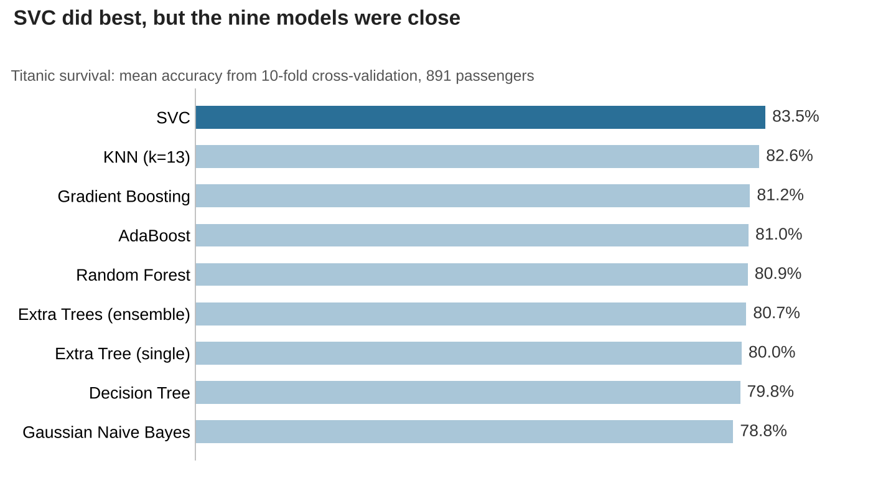

# Titanic Survival Prediction: Comparing Nine Models

I predicted survival for 891 Titanic passengers and compared nine classifiers using 10-fold cross-validation, after adding features like passenger title and family size.

SVC came out best at 83.5% accuracy, with KNN close behind at 82.6%. The gap between the top models is small, so I wouldn't read too much into the ranking.

